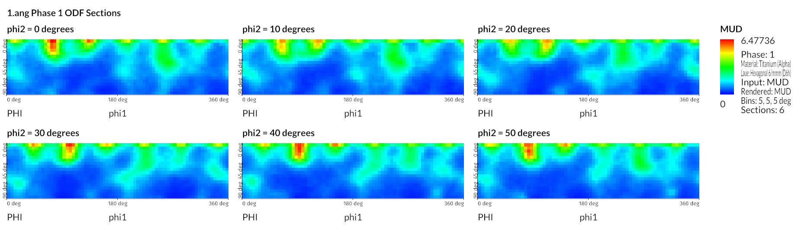

# Write ODF Sections

## Group (Subgroup)

MTRSim (Output)

## Description

This **Filter** renders a conventional montage of constant-`phi2` sections from a scalar Orientation Distribution Function (ODF) on a full, regular Bunge-Euler grid. Each panel displays `phi1` horizontally from 0 degrees to 360 degrees and `PHI` vertically over the rectangular plotting region for the selected Laue class. All panels use one MUD color scale, which makes peak and valley strengths directly comparable across sections.

The selected ODF must contain only the orientations for the selected phase. For multiphase EBSD data, compute a separate ODF with a phase-specific mask before using this **Filter**. The **Crystal Structures**, **Material Names**, and **Phase Index** parameters label the montage and determine its symmetry limits; they do not separate phases in an already-computed ODF.

## Input ODF Grid

The input must be a zero-origin, uniformly spaced **Image Geometry** that covers the complete Bunge cube. The scalar ODF **Data Array** must be directly under its cell **Attribute Matrix** and contain one `Float32` or `Float64` value per cell.

| Image axis | Bunge angle | Required extent | Storage role |
|---|---|---|---|
| **X** | `phi2` | 0 degrees to 360 degrees | Fastest-varying |
| **Y** | `PHI` | 0 degrees to 180 degrees | Middle |
| **Z** | `phi1` | 0 degrees to 360 degrees | Slowest-varying |

The dimensions multiplied by the uniform spacing must equal `(360, 180, 360)` degrees in `(X, Y, Z)` order. A 5 degree grid therefore has dimensions `(72, 36, 72)`. Cropped fundamental-zone grids and transposed grids are not accepted. Cell values are interpreted at bin centers; for a 5 degree grid, the centers are 2.5, 7.5, 12.5 degrees, and so on.

## Input Units

The renderer always displays Multiples of Uniform Density (MUD). Input already expressed in **MUD** is used directly. **Count-Density** input is converted independently for each `PHI` row:

```text
MUD(i, j, k) = CountDensity(i, j, k)
             * 8 * pi^2
             / (dphi1 * dPHI * dphi2 * sin(PHI_center(j)))
```

The angular spacings in this formula are in radians. Because the full grid is cell-centered, `PHI_center(j)` never lies exactly on a Bunge pole. This is the same conversion used by the Compute ODF From Euler Angles **Filter**, so mathematically equivalent MUD and Count-Density arrays render identically.

## Phase Metadata

**Crystal Structures** must be a scalar `UInt32` **Ensemble** array of EbsdLib crystal-structure codes. **Material Names** must be a `StringArray` with the same tuple count. **Phase Index** is one-based, must select an existing nonzero ensemble tuple, and supplies both the crystal structure and material name shown in the image.

When the input ODF was imported without ensemble metadata, create matching **Crystal Structures** and **Material Names** arrays first, for example with the Create Ensemble Info **Filter**. The renderer can validate the selected metadata tuple but cannot prove that the input ODF was computed from that phase alone.

## Euler Plotting Limits

`phi1` spans 0 degrees to 360 degrees for every supported Laue class. The displayed `PHI` and `phi2` limits are:

| EbsdLib crystal structure | Laue class | `PHI` maximum | `phi2` maximum |
|---|---|---:|---:|
| Hexagonal High | `6/mmm` | 90 degrees | 60 degrees |
| Cubic High | `m-3m` | 90 degrees | 90 degrees |
| Hexagonal Low | `6/m` | 180 degrees | 60 degrees |
| Cubic Low | `m-3` | 90 degrees | 180 degrees |
| Triclinic | `-1` | 180 degrees | 360 degrees |
| Monoclinic | `2/m`, EbsdLib unique-axis convention | 90 degrees | 360 degrees |
| Orthorhombic | `mmm` | 90 degrees | 180 degrees |
| Tetragonal Low | `4/m` | 180 degrees | 90 degrees |
| Tetragonal High | `4/mmm` | 90 degrees | 90 degrees |
| Trigonal Low | `-3` | 180 degrees | 120 degrees |
| Trigonal High | `-3m` | 90 degrees | 120 degrees |

The cubic regions are conventional rectangular Euler plotting boxes rather than the nonrectangular strict fundamental zones.

## Section Angles and Interpolation

For `N` sections and the selected symmetry limit `phi2Max`, section `s` is drawn at:

```text
phi2Section(s) = s * phi2Max / N,  s = 0 ... N - 1
```

The redundant `phi2Max` endpoint is omitted. The default six sections for Hexagonal High are therefore 0, 10, 20, 30, 40, and 50 degrees.

Each requested section is linearly interpolated between the neighboring cell-centered `phi2` planes. Interpolation is periodic over the full 360 degree input grid, so the 0 degree section interpolates between the final and first planes. No interpolation is performed along `phi1` or `PHI`.

## Color and Scale

**Color Table Preset** selects the shared RGB color map; the default is *Rainbow*. **Automatic** scale mode applies the range `[0, maximum displayed MUD]`, where the maximum is evaluated after Count-Density conversion and exact-section interpolation. **Manual** mode requires finite values satisfying `0 <= minimum < maximum`; values outside the range use the endpoint colors. The shared color bar reports the applied MUD range.

An all-zero rendered result has no meaningful automatic scale and is rejected. Negative or non-finite ODF values are always errors and are never silently clipped.

## Outputs

At least one output must be enabled:

- **Write PNG** writes the annotated montage atomically to a `.png` file. An existing destination is not replaced unless encoding succeeds.
- **Save as Image Geometry** creates an RGB **Image Geometry**. Its `Cell Data/ODF Sections RGB` array is `UInt8` with three components and contains the same RGB bytes as the decoded PNG.

The **Section Width** controls each panel's horizontal pixel count. Panel height is derived from the angular aspect ratio, and **Sections Per Row** controls the montage layout. The final row can be partially filled.

## Errors and Preflight

Preflight rejects an invalid ODF type or placement, a nonzero origin, nonuniform or nonpositive spacing, an incomplete full-Bunge extent, a mismatched ODF tuple count, mismatched ensemble metadata, an invalid phase index or crystal structure, fewer than two sections, an invalid row count, a section width below 128 pixels, an invalid color preset or manual scale, a non-`.png` output path, and configurations with both outputs disabled.

Preflight reports the selected phase, material, Laue class, input and rendered units, full grid dimensions and spacing, Euler plotting limits, exact section angles, montage layout and dimensions, and scale mode.

% Auto generated parameter table will be inserted here

## Example



*Phase 1, Titanium (Alpha), from `1.ang`; 5 degree full-Bunge grid in MUD, with sections at 0, 10, 20, 30, 40, and 50 degrees and the Rainbow color-table preset.*

## References

- H.-J. Bunge, *Texture Analysis in Materials Science: Mathematical Methods*, Butterworths, 1982. The montage follows the standard Bunge constant-`phi2` Euler-section convention.
- [MTEX ODF plotting documentation](https://mtex-toolbox.github.io/ODFPlot.html). The endpoint-excluded section sequence follows the conventional MTEX default; the rendered values need not be pixel-identical because the originating ODF estimators can use different smoothing kernels.

## See Also

- [Compute ODF From Euler Angles](ComputeODFFilter.md) computes a phase-isolated full-grid MUD or Count-Density array suitable for this **Filter**.

## License & Copyright

Please see the description file distributed with this **Plugin**.

## DREAM3D-NX Help

If you need help, need to file a bug report, or want to request a new feature, please head over to the [DREAM3DNX-Issues](https://github.com/BlueQuartzSoftware/DREAM3DNX-Issues/discussions) GitHub site where the community of DREAM3D-NX users can help answer your questions.
